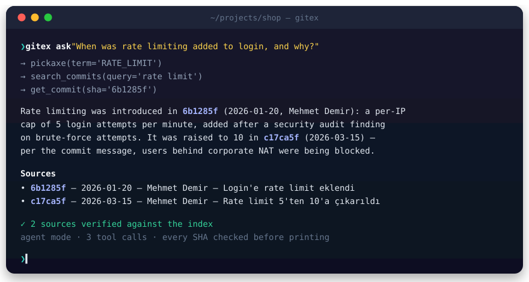
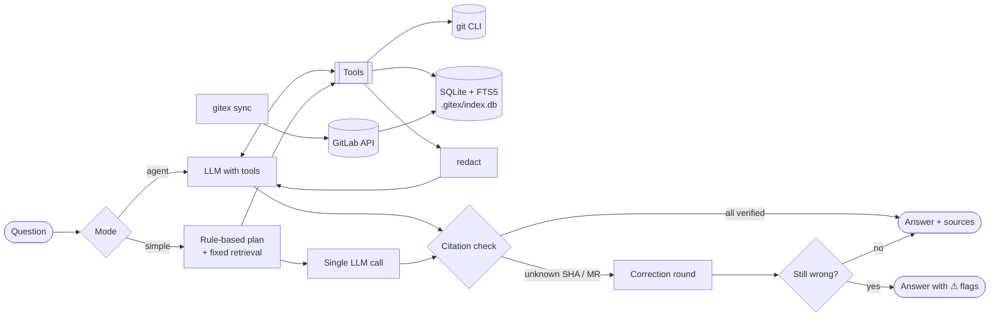

<div align="center">

<picture>
  <source media="(prefers-color-scheme: dark)" srcset="docs/assets/logo-dark.svg">
  
</picture>

### Ask your Git history anything — and get answers with receipts.

**gitex** is a command-line tool that answers *what changed, when, who did it, and why* in plain
English or Turkish. Every claim is backed by a commit SHA, a date and, when available, the GitLab
merge request and issue behind it. Every reference is checked before it reaches you.

[](https://github.com/tufekcii/gitex/actions/workflows/ci.yml)
[](https://www.python.org/)
[](https://docs.astral.sh/uv/)
[](https://docs.astral.sh/ruff/)
[](https://mypy-lang.org/)
[](LICENSE)

[Quick start](#quick-start) ·
[Features](#features) ·
[How it works](#how-it-works) ·
[Configuration](#configuration) ·
[Evaluation](#evaluation) ·
[Türkçe](README.tr.md)

<br>



<sub>Illustrative session against the repository bundled with the test suite.</sub>

</div>

---

## Why gitex?

`git log`, `git blame` and `git log -S` already hold the answers — but only if you know which
command to run, which path to look at and which string to search for. Code review context lives
somewhere else entirely, in merge requests and issues.

gitex puts an LLM in front of those tools and keeps it honest:

- **It searches like an engineer would.** Pickaxe for "when was X added", line history for "how did
  these lines evolve", blame for "who last touched this", full-text search for topics.
- **It cites everything.** Short SHA, date and author for every factual claim; `!MR` links when GitLab
  is configured.
- **It does not make things up.** Every SHA and MR in the answer is verified against the index. A
  fabricated reference is sent back to the model for correction once, and flagged
  `⚠ doğrulanamadı` (unverified) if it survives.
- **It runs on whatever you have.** Free cloud tiers (Groq, Google Gemini, OpenRouter), local models
  (Ollama, vLLM), or Claude and OpenAI. Your history is indexed on disk; diffs are never stored.

<a id="features"></a>

## ✨ Features

<table>
<tr>
<td width="50%" valign="top">

**🔎 Git-native retrieval**<br>
Pickaxe (`-S` / `-G`), line-range history (`-L`), blame, rename-aware file history, tags and
branches containing a commit. Merges and empty repositories are handled correctly.

</td>
<td width="50%" valign="top">

**🧾 Verified citations**<br>
Every SHA and `!MR` in an answer is resolved against the index and Git. Unverifiable references
trigger a correction round, then an explicit warning.

</td>
</tr>
<tr>
<td valign="top">

**🌍 Bilingual by design**<br>
Answers in the language of the question. Search folds Turkish characters (`ödeme` ↔ `odeme`,
`kullanıcı` ↔ `kullanici`) and strips common suffixes.

</td>
<td valign="top">

**🦊 GitLab context**<br>
Merge requests, review comments with file and line, and closed or related issues. Incremental
sync, squash and merge commits mapped back to their MR.

</td>
</tr>
<tr>
<td valign="top">

**🧠 Any model, two modes**<br>
`agent` mode lets capable models call tools freely. `simple` mode does fixed retrieval and a single
call, so small local models still give grounded answers.

</td>
<td valign="top">

**🔐 Private by default**<br>
API keys, tokens, passwords, private keys, JWTs and connection strings are masked before anything
is sent. Excluded paths never leave your machine; diffs can be turned off entirely.

</td>
</tr>
<tr>
<td valign="top">

**⚡ Fast, incremental index**<br>
SQLite + FTS5 per repository. Only new commits are indexed; history rewritten by a rebase or
force-push is detected and cleaned up.

</td>
<td valign="top">

**📏 Measurable**<br>
A bundled evaluation set scores source accuracy and fabrication rate, so you can compare models
on the same questions.

</td>
</tr>
</table>

<a id="quick-start"></a>

## 🚀 Quick start

You only need `git`. The installer sets up everything else — [uv](https://docs.astral.sh/uv/),
a private Python 3.12 (your system Python is untouched) and the `gitex` command on your `PATH` —
then opens the setup wizard.

**1. Clone and install**

<table>
<tr><th>Windows</th><th>macOS / Linux</th></tr>
<tr>
<td>

```powershell
git clone https://github.com/tufekcii/gitex.git
cd gitex
.\install.cmd
```

</td>
<td>

```bash
git clone https://github.com/tufekcii/gitex.git
cd gitex
./install.sh
```

</td>
</tr>
</table>

On Windows you can also just double-click `install.cmd`. Re-running the installer is safe and is
also how you update after a `git pull`.

**2. Answer a few questions** — the wizard starts automatically (or run `gitex setup` any time):

```text
Dil / Language
    1) Türkçe
    2) English           — everything from here on is in the language you pick
1. Which AI service do you want to use?
    1) Groq             — free tier, very fast
    2) Google Gemini    — free tier
    3) OpenRouter       — one key, many models; ':free' ones cost nothing
    4) Ollama           — runs on your machine, no key at all
    5) Claude           6) OpenAI           7) vLLM / any OpenAI-compatible server
2. API key              pasted once, stored in your OS keychain — never in a file
3. Model                picked by number from the provider's live model list
4. Mode                 agent or simple
5. GitLab (optional)    project detected from your git remote
6. Index                built for the current repository
```

Every choice is a number. You type only your API key — and a name, if what you want isn't on the list.
On Windows the installer can also be given the language up front: `.\install.cmd -Lang en`
(`./install.sh --lang en` on macOS/Linux).

**3. Ask**

```bash
cd your-project
gitex ask "When was rate limiting added to login?"
```

`gitex doctor` checks the whole setup at any time and tells you exactly what to fix.

> [!TIP]
> You never have to open a config file. Everything — model, keys, GitLab, privacy — is managed with
> `gitex setup`, `gitex config` and `gitex auth`.

## 💬 Usage

### Ask anything

```bash
gitex ask "Why did payment/service.py change so much in the last 3 months?"
gitex ask "What did a1b2c3d do, which MR brought it in, and what came up in review?"
gitex ask "When did user deletion switch to soft-delete, and who did it?"
gitex ask "Login'deki rate limit ne zaman eklendi?"          # Turkish works too
```

Narrow the search, change the strategy or audit what is sent:

```bash
gitex ask "..." --path payment/ --since 2026-01-01 --until 2026-03-31
gitex ask "..." --mode simple          # fixed retrieval + one call, for small models
gitex ask "..." --show-context         # print everything sent to the LLM, before sending it
gitex ask "..." --json                 # answer + verified sources, machine-readable
```

### Commands

**Ask and explore**

| Command | What it does | Needs an LLM |
|---|---|:---:|
| `gitex ask "question"` | Answer a question with cited sources | ✓ |
| `gitex explain <sha \| !MR>` | Explain a commit or a merge request | ✓ |
| `gitex chat` | Interactive session that keeps follow-up context | ✓ |
| `gitex when "expression"` | When an expression was added or removed (pickaxe) | — |
| `gitex file <path> [--llm]` | How a file evolved: authors, renames, activity | optional |

**Set up and manage**

| Command | What it does |
|---|---|
| `gitex setup` | Guided setup: model, API key, GitLab, index |
| `gitex doctor [--offline]` | Check git, settings, index, model and GitLab connectivity |
| `gitex config show` | Effective settings and where each one comes from |
| `gitex config set <key> <value>` | Change a setting (`--global` all repos · `--repo` this repo) |
| `gitex config get / unset <key>` | Read or remove a setting |
| `gitex config list-keys` | Every setting with its type and default |
| `gitex auth login [llm\|gitlab]` | Store an API key or token in the OS keychain (hidden input) |
| `gitex auth status` / `logout` | See which secret is used and from where · remove it |

**Data**

| Command | What it does |
|---|---|
| `gitex index [--rebuild]` | Index local Git history (incremental; `ask` does this for you) |
| `gitex sync [--full]` | Sync GitLab merge requests, review notes and issues |
| `gitex status` | Index state, last sync and configuration summary |
| `gitex init` | Create `.gitex/` and add it to `.gitignore` (done by `setup`) |

Global option: `-C, --repo PATH` targets a repository in another directory.

> [!NOTE]
> **Two languages, your choice.** The installer asks for Turkish or English first; every message,
> table, prompt and `--help` text then follows that choice. Change it any time with
> `gitex config set ui.language en` (or `tr`). Answers always follow the language of your question.

<details>
<summary><b>Example: <code>gitex when</code> without any LLM</b></summary>

```text
$ gitex when "debug_dump"
                                       History of 'debug_dump'
┌────────────┬─────────┬──────────────┬─────────────────┬──────────────────────────────────────┬────┐
│ Date       │ SHA     │ Author       │ What happened   │ Subject                              │ MR │
├────────────┼─────────┼──────────────┼─────────────────┼──────────────────────────────────────┼────┤
│ 2026-02-10 │ c9ea76b │ Mehmet Demir │ added (+1/-0)   │ Geçici debug_dump fonksiyonu eklendi │    │
│ 2026-02-20 │ 7121f8f │ Mehmet Demir │ removed (+0/-1) │ debug_dump kaldırıldı                │    │
└────────────┴─────────┴──────────────┴─────────────────┴──────────────────────────────────────┴────┘
First appeared: c9ea76b 2026-02-10 Mehmet Demir — Geçici debug_dump fonksiyonu eklendi
Current state: removed in 7121f8f on 2026-02-20.
```

</details>

<details>
<summary><b>Chat commands</b></summary>

| Command | Effect |
|---|---|
| `/yeni` | Start a fresh conversation |
| `/mod agent` · `/mod simple` | Switch mode mid-session |
| `/json` | Print the last answer with its sources as JSON |
| `/çık` · `Ctrl+D` | Quit |

</details>

<a id="how-it-works"></a>

## 🧭 How it works



| Tool exposed to the model | Purpose |
|---|---|
| `search_commits` | Full-text search over commit messages, with path, author and date filters |
| `pickaxe` | Commits where a string or regex was added or removed (`git log -S` / `-G`) |
| `file_history` | A file's history, following renames |
| `line_history` | How a line range evolved (`git log -L`) |
| `blame` | Which commit last touched each line |
| `get_commit` | Metadata, changed files, tags and branches, linked MR and a trimmed diff |
| `list_paths` | Find the right path by glob or substring |
| `search_mrs` · `get_mr` | Merge requests, review notes and issues — only offered when GitLab is configured |

Tool outputs are plain text sized to a character budget; truncation is always stated, so the model
knows to narrow its query.

<a id="configuration"></a>

## ⚙️ Configuration

Everything is managed from the command line — `gitex setup` for the guided path, `gitex config`
for individual settings and `gitex auth` for secrets. You never need to open a file.

```bash
gitex config show                                  # every setting, its value and where it comes from
gitex config set llm.model claude-opus-5-5         # change one setting
gitex config set privacy.send_diffs false          # booleans: true/false, yes/no, evet/hayır
gitex config set privacy.exclude_paths "*.env,secrets/**"   # lists: comma-separated
gitex config unset llm.mode                        # fall back to the default
gitex config list-keys                             # all settings with types and defaults
```

**Scope.** Model and privacy settings apply to all your repositories by default; GitLab settings
apply to the current repository. Override with `--global` or `--repo`. A repository setting wins
over a global one, and `GITEX_*` environment variables win over both
(`GITEX_LLM_PROVIDER`, `GITEX_LLM_MODEL`, `GITEX_LLM_BASE_URL`, `GITEX_LLM_MODE`,
`GITEX_GITLAB_URL`, `GITEX_GITLAB_PROJECT`).

> [!IMPORTANT]
> **Secrets never touch a file.** `gitex auth login` stores API keys and tokens in your operating
> system's keychain (Windows Credential Manager, macOS Keychain, Linux Secret Service). An
> environment variable, if set, takes precedence — `GITEX_LLM_API_KEY` (or the name in
> `llm.api_key_env`) and `GITEX_GITLAB_TOKEN` — which is handy for CI.

```bash
gitex auth login                 # LLM API key, typed hidden
gitex auth login gitlab          # GitLab token (read_api)
echo "$KEY" | gitex auth login --stdin   # non-interactive, for scripts
gitex auth status                # which secret is used and from where (masked)
gitex auth logout                # remove it from the keychain
```

<details>
<summary><b>All settings</b></summary>

| Key | Default | Description |
|---|---|---|
| `ui.language` | system language | `tr` or `en` — the interface language (global only) |
| `llm.provider` | `openai_compat` | `openai_compat` (vLLM, Ollama, OpenAI) or `anthropic` |
| `llm.model` | `qwen2.5-7b-instruct` | Model name as the endpoint expects it |
| `llm.base_url` | — | Server address; required for `openai_compat` |
| `llm.api_key_env` | `GITEX_LLM_API_KEY` | Environment variable checked before the keychain |
| `llm.mode` | `agent` | `agent` or `simple` |
| `llm.max_tool_calls` | `12` | Tool-call budget per question in agent mode |
| `llm.temperature` | `0.1` | Sent to `openai_compat` only |
| `llm.max_tokens` | provider default | 2048 for `openai_compat`, 16000 for `anthropic` |
| `llm.timeout` | `120` | Request timeout in seconds |
| `llm.tool_output_chars` | `8000` | Character budget for a single tool output |
| `llm.context_chars` | `40000` | Total context budget in simple mode |
| `llm.simple_top_n` | `6` | Commits whose details are included in simple mode |
| `llm.anthropic_fallbacks` | `true` | Let the Claude API retry a refused request on a fallback model |
| `privacy.send_diffs` | `true` | `false`: only metadata and messages reach the LLM |
| `privacy.max_diff_chars` | `12000` | Maximum diff size sent per commit |
| `privacy.exclude_paths` | `*.env, *.pem, *.key, secrets/**, *.lock` | Files whose diffs are never sent |
| `gitlab.url` | `https://gitlab.com` | GitLab instance |
| `gitlab.project` | — | `group/project` or numeric ID; enables GitLab features |
| `gitlab.per_page` | `100` | Page size for API calls |
| `gitlab.max_retries` | `5` | Retries on rate limiting |

Settings are stored as TOML in `~/.config/gitex/config.toml` and `<repo>/.gitex/config.toml`
(`gitex config path`); comments in those files are preserved when gitex writes to them.

</details>

<a id="model-providers"></a>

### Model providers

`gitex setup` covers all of these with numbered choices and lists each provider's models for you. The equivalent commands:

<details open>
<summary><b>Free options</b> — Groq, Google Gemini, OpenRouter, Ollama</summary>

| Provider | Free | Get a key | `llm.base_url` |
|---|---|---|---|
| Groq | free tier (rate-limited) | [console.groq.com/keys](https://console.groq.com/keys) | `https://api.groq.com/openai/v1` |
| Google Gemini | free tier (rate-limited) | [aistudio.google.com/apikey](https://aistudio.google.com/apikey) | `https://generativelanguage.googleapis.com/v1beta/openai/` |
| OpenRouter | models ending in `:free` | [openrouter.ai/keys](https://openrouter.ai/keys) | `https://openrouter.ai/api/v1` |
| Ollama | fully free, local | no key | `http://localhost:11434/v1` |

```bash
gitex config set llm.provider openai_compat
gitex config set llm.base_url https://api.groq.com/openai/v1
gitex config set llm.model <model-from-the-list>
gitex auth login
```

Free tiers and their limits are set by each provider and can change. If a free model handles tool
calling poorly, switch to `gitex config set llm.mode simple`.

</details>

<details>
<summary><b>Claude (Anthropic API)</b></summary>

```bash
gitex config set llm.provider anthropic
gitex config set llm.model claude-opus-5-5
gitex auth login
```

If the Claude API declines a request, it is retried server-side on a fallback model
(`gitex config set llm.anthropic_fallbacks false` to opt out).

</details>

<details>
<summary><b>Ollama</b> — local and free</summary>

```bash
gitex config set llm.provider openai_compat
gitex config set llm.base_url http://localhost:11434/v1
gitex config set llm.model qwen2.5:7b
gitex config set llm.mode simple        # usually more accurate on small models
```

No key needed for a local server.

</details>

<details>
<summary><b>vLLM</b></summary>

```bash
vllm serve Qwen/Qwen2.5-7B-Instruct --enable-auto-tool-choice --tool-call-parser hermes
```

```bash
gitex config set llm.provider openai_compat
gitex config set llm.base_url http://localhost:8000/v1
gitex config set llm.model Qwen/Qwen2.5-7B-Instruct
```

Tool calling needs `--enable-auto-tool-choice` and a parser that matches the model. Without them,
use `gitex config set llm.mode simple`.

</details>

<details>
<summary><b>OpenAI</b></summary>

```bash
gitex config set llm.provider openai_compat
gitex config set llm.base_url https://api.openai.com/v1
gitex config set llm.model <model-name>
gitex auth login
```

</details>

Run `gitex doctor` afterwards: it checks that the server answers, the model exists and the key
works — without spending tokens.

### Agent or simple?

| | `agent` | `simple` |
|---|---|---|
| How it retrieves | The model chooses tools in a loop | Keywords, code terms, paths and dates extracted by rules (one small LLM call if rules find nothing) |
| LLM calls | Several, bounded by `max_tool_calls` | One (two at most) |
| Best for | Claude, larger open models with solid tool calling | Small local models, servers without tool calling |
| Follow-ups in `chat` | Full conversation history | Previous turns included as text |

## 🦊 GitLab integration

`gitex setup` detects the project from your `origin` remote. Or step by step:

```bash
gitex config set gitlab.url https://gitlab.example.com   # skip for gitlab.com
gitex config set gitlab.project group/project
gitex auth login gitlab                                  # a token with read_api scope
gitex sync                                               # incremental; --full to start over
```

- Syncs merged and open merge requests, non-system review notes (with file and line for diff
  comments), and issues an MR closes or relates to.
- Incremental by `updated_after`; MRs closed without merging are removed from the index.
- Honors `Retry-After` on HTTP 429 and paginates automatically.
- Maps commits to MRs through the MR's commits, `merge_commit_sha` and `squash_commit_sha`.

Without a `[gitlab]` section gitex works fully on local Git, and the MR tools are never offered to
the model.

## 🔐 Privacy & security

| Safeguard | Detail |
|---|---|
| No diffs at rest | The index stores metadata and messages; diffs are read from Git on demand |
| Secret masking | Keys, tokens, passwords, private keys, JWTs and connection strings become `[REDACTED]` |
| Excluded paths | Files matching `exclude_paths` never have their diff sent |
| Metadata-only mode | `send_diffs = false` removes diffs and code lines from every tool |
| Audit before sending | `--show-context` prints the exact messages before the request is made |
| No secrets on disk | Keys and tokens live in the OS keychain (or environment variables), never in config files |

<a id="evaluation"></a>

## 📊 Evaluation

The repository ships with a deterministic fixture repository and 19 questions in English and
Turkish, including two with no answer, to catch models that invent one.

```bash
uv run python -m gitex.evals                                     # model from your config
uv run python -m gitex.evals --provider anthropic --model claude-opus-5-5
uv run python -m gitex.evals --mode simple --model qwen2.5:7b \
    --base-url http://localhost:11434/v1 --output report.json
```

| Metric | Meaning |
|---|---|
| Source recall | Share of expected commits cited as verified sources |
| Full-hit rate | Questions where every expected commit was cited |
| Fabricated-reference rate | Unverifiable references ÷ all references in answers |
| Not-found accuracy | Unanswerable questions answered "not found" without a SHA |
| Text match | Expected facts (names, dates, versions) present in the answer |

Questions live in [`evals/questions.toml`](evals/questions.toml).

## 🗂 Project layout

```text
src/gitex/
├── cli.py            Typer commands
├── config.py         TOML + environment loading, validation (pydantic)
├── session.py        Question/answer session shared by ask, explain and chat
├── manage.py         setup, config, auth and doctor commands
├── credentials.py    OS keychain access for API keys and tokens
├── redact.py         Secret masking
├── git/              git CLI reader and data models
├── index/            SQLite schema and migrations, incremental indexer, search
├── gitlab/           python-gitlab wrapper, incremental sync
├── llm/              Provider protocol, OpenAI-compatible and Anthropic adapters
├── agent/            Tools, tool-use loop, simple mode, prompts, citation checks
└── evals/            Fixture repository builder and evaluation runner
```

Design decisions and the reasoning behind each dependency are recorded in
[`docs/decisions.md`](docs/decisions.md) (Turkish).

## 🛠 Development

```bash
uv sync                                            # project environment for contributors
uv run pytest                                      # no test touches the network
uv run ruff check . && uv run ruff format --check .
uv run mypy                                        # strict
```

CI ([GitHub Actions](.github/workflows/ci.yml)) runs lint and type checking, the test suite on
Linux and Windows, and the installer end to end on clean Linux and Windows machines for every push
and pull request.

<details>
<summary><b>Uninstall</b></summary>

```bash
gitex auth logout && gitex auth logout gitlab   # optional: remove stored secrets
./install.sh --uninstall                         # Windows: .\install.cmd -Uninstall
```

Settings in `~/.config/gitex/` and `.gitex/` folders inside repositories are left in place.

</details>

## 🗺 Roadmap

- [ ] Hybrid search: FTS5 + embeddings with `sqlite-vec` (the search interface is already abstracted for it)
- [ ] MCP server built on the `--json` output
- [ ] Streaming answers in `ask` and `chat`
- [ ] GitHub pull requests alongside GitLab merge requests

## 📄 License

[MIT](LICENSE) · Changes are tracked in [CHANGELOG.md](CHANGELOG.md).
