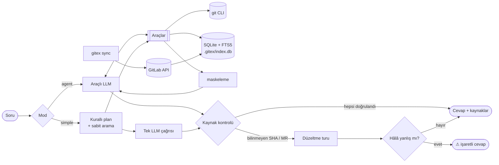

<div align="center">

<picture>
  <source media="(prefers-color-scheme: dark)" srcset="docs/assets/logo-dark.svg">
  
</picture>

### Git geçmişine her şeyi sorun — cevaplar kanıtıyla gelsin.

**gitex**, *ne değişti, ne zaman, kim yaptı ve neden* sorularını Türkçe ya da İngilizce yanıtlayan
bir komut satırı aracıdır. Her iddia bir commit SHA'sı, tarih ve varsa arkasındaki GitLab merge
request'i ve issue'su ile desteklenir. Her referans size ulaşmadan önce doğrulanır.

[](https://github.com/tufekcii/gitex/actions/workflows/ci.yml)
[](https://www.python.org/)
[](https://docs.astral.sh/uv/)
[](https://docs.astral.sh/ruff/)
[](https://mypy-lang.org/)
[](LICENSE)

[Hızlı başlangıç](#hizli-baslangic) ·
[Özellikler](#ozellikler) ·
[Nasıl çalışır](#nasil-calisir) ·
[Yapılandırma](#yapilandirma) ·
[Değerlendirme](#degerlendirme) ·
[English](README.md)

<br>


<sub>Test paketindeki örnek depo üzerinde temsilî bir oturum.</sub>

</div>

---

## Neden gitex?

Cevaplar zaten `git log`, `git blame` ve `git log -S` içinde — ama yalnızca hangi komutu, hangi
yolda, hangi metinle çalıştıracağınızı biliyorsanız. Review bağlamı ise bambaşka bir yerde: merge
request'lerde ve issue'larda.

gitex bu araçların önüne bir LLM koyar ve onu dürüst tutar:

- **Bir mühendis gibi arar.** "X ne zaman eklendi" için pickaxe, "bu satırlar nasıl değişti" için
  satır geçmişi, "buna en son kim dokundu" için blame, konular için tam metin arama.
- **Her şeyi kaynaklandırır.** Her olgusal iddia için kısa SHA, tarih ve yazar; GitLab ayarlıysa
  `!MR` linkleri.
- **Uydurmaz.** Cevaptaki her SHA ve MR indekse karşı doğrulanır. Uydurma bir referans bir kez
  düzeltilmek üzere modele geri gönderilir; yine düzelmezse `⚠ doğrulanamadı` olarak işaretlenir.
- **Elinizde ne varsa onunla çalışır.** Ücretsiz bulut katmanları (Groq, Google Gemini, OpenRouter),
  yerel modeller (Ollama, vLLM) ya da Claude ve OpenAI. Geçmiş diskte indekslenir; diff'ler asla saklanmaz.

<a id="ozellikler"></a>

## ✨ Özellikler

<table>
<tr>
<td width="50%" valign="top">

**🔎 Git'e özgü arama**<br>
Pickaxe (`-S` / `-G`), satır aralığı geçmişi (`-L`), blame, yeniden adlandırmaları izleyen dosya
geçmişi, bir commit'i içeren tag ve branch'ler. Merge'ler ve boş depolar doğru ele alınır.

</td>
<td width="50%" valign="top">

**🧾 Doğrulanmış kaynaklar**<br>
Cevaptaki her SHA ve `!MR` indekse ve git'e karşı çözülür. Doğrulanamayan referans bir düzeltme
turu, ardından açık bir uyarı tetikler.

</td>
</tr>
<tr>
<td valign="top">

**🌍 Baştan iki dilli**<br>
Soru hangi dildeyse cevap o dilde. Arama Türkçe karakterleri katlar (`ödeme` ↔ `odeme`,
`kullanıcı` ↔ `kullanici`) ve yaygın ekleri kırpar.

</td>
<td valign="top">

**🦊 GitLab bağlamı**<br>
Merge request'ler, dosya ve satır bilgisiyle review yorumları, kapatılan ya da ilişkili issue'lar.
Artımlı senkron; squash ve merge commit'leri MR'larına eşlenir.

</td>
</tr>
<tr>
<td valign="top">

**🧠 Her model, iki mod**<br>
`agent` modu yetenekli modellerin araçları serbestçe çağırmasına izin verir. `simple` modu sabit
arama ve tek çağrı yapar; küçük yerel modeller de kaynaklı cevap verir.

</td>
<td valign="top">

**🔐 Varsayılan olarak gizli**<br>
API anahtarı, token, parola, private key, JWT ve bağlantı dizeleri gönderilmeden önce maskelenir.
Hariç tutulan yollar makinenizden çıkmaz; diff gönderimi tamamen kapatılabilir.

</td>
</tr>
<tr>
<td valign="top">

**⚡ Hızlı, artımlı indeks**<br>
Depo başına SQLite + FTS5. Yalnızca yeni commit'ler indekslenir; rebase ya da force-push ile
yeniden yazılan geçmiş tespit edilip temizlenir.

</td>
<td valign="top">

**📏 Ölçülebilir**<br>
Paketle gelen değerlendirme seti kaynak isabetini ve uydurma oranını puanlar; modelleri aynı
sorularda karşılaştırabilirsiniz.

</td>
</tr>
</table>

<a id="hizli-baslangic"></a>

## 🚀 Hızlı başlangıç

Yalnızca `git` gerekir. Kurulum betiği gerisini halleder — [uv](https://docs.astral.sh/uv/),
size özel bir Python 3.12 (sistemdeki Python'a dokunulmaz) ve `PATH`'te `gitex` komutu — ardından
kurulum sihirbazını açar.

**1. Klonlayın ve kurun**

<table>
<tr><th>Windows</th><th>macOS / Linux</th></tr>
<tr>
<td>

```powershell
git clone https://github.com/tufekcii/gitex.git
cd gitex
.\install.cmd
```

</td>
<td>

```bash
git clone https://github.com/tufekcii/gitex.git
cd gitex
./install.sh
```

</td>
</tr>
</table>

Windows'ta `install.cmd`'ye çift tıklamak da yeterli. Kurulumu tekrar çalıştırmak güvenlidir;
`git pull` sonrası güncelleme de aynı komutla yapılır.

**2. Birkaç soruyu yanıtlayın** — sihirbaz kendiliğinden açılır (istediğiniz zaman `gitex setup`):

```text
Dil / Language
    1) Türkçe           — bundan sonraki her şey seçtiğiniz dilde
    2) English
1. Hangi yapay zekâ servisini kullanacaksın?
    1) Groq             — ücretsiz katmanı var, çok hızlı
    2) Google Gemini    — ücretsiz katmanı var
    3) OpenRouter       — tek anahtarla birçok model; ':free' olanlar ücretsiz
    4) Ollama           — kendi bilgisayarında çalışır, anahtar gerekmez
    5) Claude           6) OpenAI           7) vLLM / başka OpenAI uyumlu sunucu
2. API anahtarı          bir kez yapıştırılır, anahtar kasasına kaydedilir — asla dosyaya değil
3. Model                 sağlayıcının güncel model listesinden numarayla seçilir
4. Çalışma modu          agent ya da simple
5. GitLab (opsiyonel)    proje git remote'undan algılanır
6. İndeks                bulunduğunuz depo için kurulur
```

Her seçim numaralıdır. Yalnızca API anahtarınızı — ve istediğiniz şey listede yoksa adını — yazarsınız.
Dil kurulumda baştan da verilebilir: `.\install.cmd -Lang tr` (macOS/Linux: `./install.sh --lang tr`).

**3. Sorun**

```bash
cd projeniz
gitex ask "Login'deki rate limit ne zaman eklendi?"
```

`gitex doctor` kurulumun tamamını istediğiniz an kontrol eder ve neyi düzeltmeniz gerektiğini söyler.

> [!TIP]
> Hiçbir ayar dosyasını açmanız gerekmez. Model, anahtarlar, GitLab, gizlilik — hepsi
> `gitex setup`, `gitex config` ve `gitex auth` ile yönetilir.

## 💬 Kullanım

### Her şeyi sorun

```bash
gitex ask "payment/service.py son 3 ayda neden bu kadar değişti?"
gitex ask "a1b2c3d commit'i ne yaptı, hangi MR ile geldi, review'da ne tartışıldı?"
gitex ask "Kullanıcı silme davranışı ne zaman soft-delete'e döndü ve kim yaptı?"
gitex ask "When was rate limiting added to login?"          # İngilizce de olur
```

Aramayı daraltın, stratejiyi değiştirin ya da gönderileni denetleyin:

```bash
gitex ask "..." --path payment/ --since 2026-01-01 --until 2026-03-31
gitex ask "..." --mode simple          # sabit arama + tek çağrı, küçük modeller için
gitex ask "..." --show-context         # LLM'e gidecek her şeyi göndermeden önce bas
gitex ask "..." --json                 # cevap + doğrulanmış kaynaklar, makine-okunur
```

### Komutlar

**Sor ve keşfet**

| Komut | Ne yapar | LLM gerekir |
|---|---|:---:|
| `gitex ask "soru"` | Soruyu kaynaklarıyla yanıtlar | ✓ |
| `gitex explain <sha \| !MR>` | Bir commit'i ya da merge request'i açıklar | ✓ |
| `gitex chat` | Takip sorularında bağlamı koruyan etkileşimli oturum | ✓ |
| `gitex when "ifade"` | Bir ifadenin ne zaman eklendiği/kaldırıldığı (pickaxe) | — |
| `gitex file <yol> [--llm]` | Dosyanın evrimi: yazarlar, yeniden adlandırmalar, aktivite | opsiyonel |

**Kur ve yönet**

| Komut | Ne yapar |
|---|---|
| `gitex setup` | Adım adım kurulum: model, API anahtarı, GitLab, indeks |
| `gitex doctor [--offline]` | git, ayarlar, indeks, model ve GitLab bağlantısını kontrol eder |
| `gitex config show` | Etkin ayarlar ve her birinin nereden geldiği |
| `gitex config set <ayar> <değer>` | Bir ayarı değiştirir (`--global` tüm depolar · `--repo` bu depo) |
| `gitex config get / unset <ayar>` | Bir ayarı okur ya da kaldırır |
| `gitex config list-keys` | Tüm ayarlar, türleri ve varsayılanları |
| `gitex auth login [llm\|gitlab]` | API anahtarını/token'ı anahtar kasasına kaydeder (gizli giriş) |
| `gitex auth status` / `logout` | Hangi sırrın nereden okunduğu · kasadan silme |

**Veri**

| Komut | Ne yapar |
|---|---|
| `gitex index [--rebuild]` | Yerel git geçmişini indeksler (artımlı; `ask` bunu kendisi yapar) |
| `gitex sync [--full]` | GitLab merge request, review yorumu ve issue senkronu |
| `gitex status` | İndeks durumu, son senkron ve config özeti |
| `gitex init` | `.gitex/` oluşturur ve `.gitignore`'a ekler (`setup` bunu yapar) |

Genel seçenek: `-C, --repo YOL` başka bir dizindeki depoyu hedefler.

> [!NOTE]
> **İki dil, seçim sizin.** Kurulum önce Türkçe mi İngilizce mi diye sorar; bütün mesajlar, tablolar,
> sorular ve `--help` metinleri bu seçimi izler. İstediğiniz zaman değiştirin:
> `gitex config set ui.language tr` (ya da `en`). Cevaplar her zaman sorunun dilinde gelir.

<details>
<summary><b>Örnek: LLM olmadan <code>gitex when</code></b></summary>

```text
$ gitex when "debug_dump"
                                         'debug_dump' geçmişi
┌────────────┬─────────┬──────────────┬────────────────────┬─────────────────────────────────────┬────┐
│ Tarih      │ SHA     │ Yazar        │ Ne oldu            │ Konu                                │ MR │
├────────────┼─────────┼──────────────┼────────────────────┼─────────────────────────────────────┼────┤
│ 2026-02-10 │ c9ea76b │ Mehmet Demir │ eklendi (+1/-0)    │ Geçici debug_dump fonksiyonu        │    │
│            │         │              │                    │ eklendi                             │    │
│ 2026-02-20 │ 7121f8f │ Mehmet Demir │ kaldırıldı (+0/-1) │ debug_dump kaldırıldı               │    │
└────────────┴─────────┴──────────────┴────────────────────┴─────────────────────────────────────┴────┘
İlk ortaya çıkış: c9ea76b 2026-02-10 Mehmet Demir — Geçici debug_dump fonksiyonu eklendi
Son durum: 7121f8f 2026-02-20 ile kaldırıldı.
```

</details>

<details>
<summary><b>Chat komutları</b></summary>

| Komut | Etkisi |
|---|---|
| `/yeni` | Yeni bir konuşma başlatır |
| `/mod agent` · `/mod simple` | Oturum ortasında mod değiştirir |
| `/json` | Son cevabı kaynaklarıyla JSON olarak basar |
| `/çık` · `Ctrl+D` | Çıkış |

</details>

<a id="nasil-calisir"></a>

## 🧭 Nasıl çalışır



| Modele sunulan araç | Amacı |
|---|---|
| `search_commits` | Commit mesajlarında tam metin arama; yol, yazar ve tarih filtreleri |
| `pickaxe` | Bir metnin ya da regex'in eklendiği/kaldırıldığı commit'ler (`git log -S` / `-G`) |
| `file_history` | Yeniden adlandırmaları izleyen dosya geçmişi |
| `line_history` | Bir satır aralığının evrimi (`git log -L`) |
| `blame` | Her satıra en son hangi commit'in dokunduğu |
| `get_commit` | Metadata, değişen dosyalar, tag ve branch'ler, bağlı MR ve kırpılmış diff |
| `list_paths` | Glob ya da alt dize ile doğru yolu bulur |
| `search_mrs` · `get_mr` | Merge request, review yorumu ve issue'lar — yalnızca GitLab ayarlıysa sunulur |

Araç çıktıları karakter bütçesine göre boyutlanmış sade metindir; kırpma her zaman belirtilir, böylece
model sorgusunu daraltması gerektiğini bilir.

<a id="yapilandirma"></a>

## ⚙️ Yapılandırma

Her şey komut satırından yönetilir — yönlendirmeli yol için `gitex setup`, tek tek ayarlar için
`gitex config`, sırlar için `gitex auth`. Hiçbir dosyayı açmanız gerekmez.

```bash
gitex config show                                  # tüm ayarlar, değerleri ve kaynakları
gitex config set llm.model claude-opus-5-5         # tek bir ayarı değiştir
gitex config set privacy.send_diffs hayır          # evet/hayır, true/false
gitex config set privacy.exclude_paths "*.env,secrets/**"   # listeler: virgülle
gitex config unset llm.mode                        # varsayılana dön
gitex config list-keys                             # tüm ayarlar, türleri ve varsayılanları
```

**Kapsam.** Model ve gizlilik ayarları varsayılan olarak tüm depolarınız için geçerlidir; GitLab
ayarları bulunduğunuz depo içindir. `--global` ya da `--repo` ile değiştirebilirsiniz. Depo ayarı
global ayarı, `GITEX_*` ortam değişkenleri ikisini de ezer (`GITEX_LLM_PROVIDER`,
`GITEX_LLM_MODEL`, `GITEX_LLM_BASE_URL`, `GITEX_LLM_MODE`, `GITEX_GITLAB_URL`,
`GITEX_GITLAB_PROJECT`).

> [!IMPORTANT]
> **Sırlar hiçbir dosyaya yazılmaz.** `gitex auth login` API anahtarlarını ve token'ları işletim
> sisteminin anahtar kasasına (Windows Credential Manager, macOS Keychain, Linux Secret Service)
> kaydeder. Tanımlıysa ortam değişkeni önceliklidir — `GITEX_LLM_API_KEY` (ya da
> `llm.api_key_env`'deki ad) ve `GITEX_GITLAB_TOKEN` — CI için kullanışlıdır.

```bash
gitex auth login                 # LLM API anahtarı, gizli giriş
gitex auth login gitlab          # GitLab token'ı (read_api)
echo "$KEY" | gitex auth login --stdin   # betikler için etkileşimsiz
gitex auth status                # hangi sır, nereden (maskeli)
gitex auth logout                # kasadan sil
```

<details>
<summary><b>Tüm ayarlar</b></summary>

| Ayar | Varsayılan | Açıklama |
|---|---|---|
| `ui.language` | sistem dili | `tr` ya da `en` — arayüz dili (yalnızca global) |
| `llm.provider` | `openai_compat` | `openai_compat` (vLLM, Ollama, OpenAI) ya da `anthropic` |
| `llm.model` | `qwen2.5-7b-instruct` | Uç noktanın beklediği model adı |
| `llm.base_url` | — | Sunucu adresi; `openai_compat` için zorunlu |
| `llm.api_key_env` | `GITEX_LLM_API_KEY` | Kasadan önce bakılan ortam değişkeni |
| `llm.mode` | `agent` | `agent` ya da `simple` |
| `llm.max_tool_calls` | `12` | Agent modunda soru başına araç çağrısı bütçesi |
| `llm.temperature` | `0.1` | Yalnızca `openai_compat`'a gönderilir |
| `llm.max_tokens` | sağlayıcı varsayılanı | `openai_compat` için 2048, `anthropic` için 16000 |
| `llm.timeout` | `120` | İstek zaman aşımı (saniye) |
| `llm.tool_output_chars` | `8000` | Tek bir araç çıktısının karakter bütçesi |
| `llm.context_chars` | `40000` | Simple modda toplam bağlam bütçesi |
| `llm.simple_top_n` | `6` | Simple modda detayı bağlama konan commit sayısı |
| `llm.anthropic_fallbacks` | `true` | Claude API'nin reddedilen isteği yedek modelde denemesi |
| `privacy.send_diffs` | `true` | `false`: LLM'e yalnızca metadata ve mesajlar gider |
| `privacy.max_diff_chars` | `12000` | Commit başına gönderilen en büyük diff |
| `privacy.exclude_paths` | `*.env, *.pem, *.key, secrets/**, *.lock` | Diff'i hiç gönderilmeyen dosyalar |
| `gitlab.url` | `https://gitlab.com` | GitLab adresi |
| `gitlab.project` | — | `grup/proje` ya da sayısal ID; GitLab özelliklerini açar |
| `gitlab.per_page` | `100` | API sayfa boyutu |
| `gitlab.max_retries` | `5` | Hız sınırında yeniden deneme sayısı |

Ayarlar TOML olarak `~/.config/gitex/config.toml` ve `<repo>/.gitex/config.toml` içinde saklanır
(`gitex config path`); gitex yazarken dosyadaki yorumlar korunur.

</details>

<a id="model-saglayicilari"></a>

### Model sağlayıcıları

`gitex setup` bunların hepsini numaralı seçimlerle kurar ve sağlayıcının modellerini listeler. Komutla karşılıkları:

<details open>
<summary><b>Ücretsiz seçenekler</b> — Groq, Google Gemini, OpenRouter, Ollama</summary>

| Sağlayıcı | Ücretsiz | Anahtar al | `llm.base_url` |
|---|---|---|---|
| Groq | ücretsiz katman (limitli) | [console.groq.com/keys](https://console.groq.com/keys) | `https://api.groq.com/openai/v1` |
| Google Gemini | ücretsiz katman (limitli) | [aistudio.google.com/apikey](https://aistudio.google.com/apikey) | `https://generativelanguage.googleapis.com/v1beta/openai/` |
| OpenRouter | adı `:free` ile biten modeller | [openrouter.ai/keys](https://openrouter.ai/keys) | `https://openrouter.ai/api/v1` |
| Ollama | tamamen ücretsiz, yerel | anahtar gerekmez | `http://localhost:11434/v1` |

```bash
gitex config set llm.provider openai_compat
gitex config set llm.base_url https://api.groq.com/openai/v1
gitex config set llm.model <listeden-model>
gitex auth login
```

Ücretsiz katmanları ve limitlerini her sağlayıcı kendisi belirler ve değişebilir. Ücretsiz bir model
araç çağırmada zorlanırsa: `gitex config set llm.mode simple`.

</details>

<details>
<summary><b>Claude (Anthropic API)</b></summary>

```bash
gitex config set llm.provider anthropic
gitex config set llm.model claude-opus-5-5
gitex auth login
```

Claude API bir isteği reddederse istek sunucu tarafında yedek bir modelde denenir
(kapatmak için `gitex config set llm.anthropic_fallbacks false`).

</details>

<details>
<summary><b>Ollama</b> — yerel ve ücretsiz</summary>

```bash
gitex config set llm.provider openai_compat
gitex config set llm.base_url http://localhost:11434/v1
gitex config set llm.model qwen2.5:7b
gitex config set llm.mode simple        # küçük modellerde genelde daha isabetli
```

Yerel sunucu için anahtar gerekmez.

</details>

<details>
<summary><b>vLLM</b></summary>

```bash
vllm serve Qwen/Qwen2.5-7B-Instruct --enable-auto-tool-choice --tool-call-parser hermes
```

```bash
gitex config set llm.provider openai_compat
gitex config set llm.base_url http://localhost:8000/v1
gitex config set llm.model Qwen/Qwen2.5-7B-Instruct
```

Tool calling için `--enable-auto-tool-choice` ve modele uygun bir parser gerekir. Bunlar yoksa
`gitex config set llm.mode simple` kullanın.

</details>

<details>
<summary><b>OpenAI</b></summary>

```bash
gitex config set llm.provider openai_compat
gitex config set llm.base_url https://api.openai.com/v1
gitex config set llm.model <model-adı>
gitex auth login
```

</details>

Ardından `gitex doctor` çalıştırın: sunucunun yanıt verdiğini, modelin var olduğunu ve anahtarın
çalıştığını token harcamadan kontrol eder.

### Agent mı, simple mı?

| | `agent` | `simple` |
|---|---|---|
| Nasıl arar | Model döngü içinde araç seçer | Anahtar kelime, kod terimi, yol ve tarihler kurallarla çıkarılır (kurallar bir şey bulamazsa tek küçük LLM çağrısı) |
| LLM çağrısı | Birkaç tane, `max_tool_calls` ile sınırlı | Bir (en fazla iki) |
| En uygun | Claude, tool calling'i sağlam büyük açık modeller | Küçük yerel modeller, tool calling desteklemeyen sunucular |
| `chat`'te takip | Tam konuşma geçmişi | Önceki turlar metin olarak eklenir |

## 🦊 GitLab entegrasyonu

`gitex setup` projeyi `origin` remote'undan algılar. Ya da adım adım:

```bash
gitex config set gitlab.url https://gitlab.sirket.com   # gitlab.com için gerekmez
gitex config set gitlab.project grup/proje
gitex auth login gitlab                                 # read_api yetkili bir token
gitex sync                                              # artımlı; baştan için --full
```

- Merge edilmiş ve açık merge request'leri, sistem dışı review yorumlarını (diff yorumlarında dosya
  ve satırla) ve MR'ın kapattığı ya da ilişkili olduğu issue'ları senkronlar.
- `updated_after` ile artımlıdır; merge edilmeden kapatılan MR'lar indeksten silinir.
- HTTP 429'da `Retry-After`'a uyar, sayfalamayı otomatik yapar.
- Commit'leri MR'ın commit'leri, `merge_commit_sha` ve `squash_commit_sha` üzerinden MR'lara eşler.

`[gitlab]` bölümü yoksa gitex yerel git ile tam çalışır ve MR araçları modele hiç sunulmaz.

## 🔐 Gizlilik ve güvenlik

| Önlem | Ayrıntı |
|---|---|
| Diskte diff yok | İndeks metadata ve mesajları saklar; diff'ler gerektiğinde git'ten okunur |
| Sır maskeleme | Anahtar, token, parola, private key, JWT ve bağlantı dizeleri `[REDACTED]` olur |
| Hariç yollar | `exclude_paths` ile eşleşen dosyaların diff'i hiç gönderilmez |
| Yalnızca metadata | `send_diffs = false` tüm araçlardan diff ve kod satırlarını kaldırır |
| Göndermeden denetim | `--show-context` istek yapılmadan önce mesajların tamamını basar |
| Diskte sır yok | Anahtar ve token'lar işletim sisteminin anahtar kasasında (ya da ortam değişkenlerinde) durur, ayar dosyalarında asla |

<a id="degerlendirme"></a>

## 📊 Değerlendirme

Depo, deterministik bir örnek depo ve İngilizce/Türkçe 19 soruyla gelir; cevap uyduran modelleri
yakalamak için ikisinin cevabı yoktur.

```bash
uv run python -m gitex.evals                                     # config'teki model
uv run python -m gitex.evals --provider anthropic --model claude-opus-5-5
uv run python -m gitex.evals --mode simple --model qwen2.5:7b \
    --base-url http://localhost:11434/v1 --output rapor.json
```

| Metrik | Anlamı |
|---|---|
| Kaynak isabeti | Beklenen commit'lerin doğrulanmış kaynak olarak gösterilme oranı |
| Tam isabet | Beklenen commit'lerin hepsinin gösterildiği soruların oranı |
| Uydurma referans oranı | Doğrulanamayan referanslar ÷ cevaplardaki tüm referanslar |
| "Bulamadım" doğruluğu | Cevapsız sorularda SHA vermeden "bulamadım" denme oranı |
| Metin eşleşmesi | Beklenen olguların (isim, tarih, sürüm) cevapta geçmesi |

Sorular [`evals/questions.toml`](evals/questions.toml) içinde.

## 🗂 Proje yapısı

```text
src/gitex/
├── cli.py            Typer komutları
├── config.py         TOML + ortam değişkeni yükleme, doğrulama (pydantic)
├── session.py        ask, explain ve chat'in ortak soru-cevap oturumu
├── manage.py         setup, config, auth ve doctor komutları
├── credentials.py    API anahtarı ve token'lar için işletim sistemi kasası
├── redact.py         Sır maskeleme
├── git/              git CLI okuyucu ve veri modelleri
├── index/            SQLite şeması ve migration, artımlı indeksleyici, arama
├── gitlab/           python-gitlab sarmalayıcı, artımlı senkron
├── llm/              Sağlayıcı protokolü, OpenAI uyumlu ve Anthropic adaptörleri
├── agent/            Araçlar, tool-use döngüsü, simple mod, promptlar, kaynak kontrolü
└── evals/            Örnek depo kurucu ve değerlendirme koşucusu
```

Tasarım kararları ve her bağımlılığın gerekçesi [`docs/decisions.md`](docs/decisions.md) içinde.

## 🛠 Geliştirme

```bash
uv sync                                            # katkı verenler için proje ortamı
uv run pytest                                      # hiçbir test ağa çıkmaz
uv run ruff check . && uv run ruff format --check .
uv run mypy                                        # strict
```

CI ([GitHub Actions](.github/workflows/ci.yml)) her push ve pull request'te lint ve tip denetimini,
Linux ve Windows'ta testleri, temiz Linux ve Windows makinelerde de kurulumu uçtan uca çalıştırır.

<details>
<summary><b>Kaldırma</b></summary>

```bash
gitex auth logout && gitex auth logout gitlab   # opsiyonel: kayıtlı sırları sil
./install.sh --uninstall                         # Windows: .\install.cmd -Uninstall
```

`~/.config/gitex/` içindeki ayarlar ve depolardaki `.gitex/` klasörleri yerinde kalır.

</details>

## 🗺 Yol haritası

- [ ] Hibrit arama: FTS5 + `sqlite-vec` ile embedding (arama arayüzü buna göre soyutlandı)
- [ ] `--json` çıktısı üzerine kurulu bir MCP sunucusu
- [ ] `ask` ve `chat`'te akışlı (streaming) cevaplar
- [ ] GitLab merge request'lerinin yanında GitHub pull request'leri

## 📄 Lisans

[MIT](LICENSE) · Değişiklikler [CHANGELOG.md](CHANGELOG.md) içinde.
